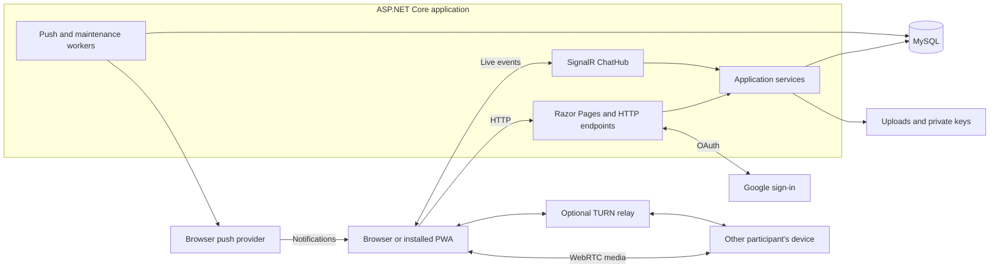
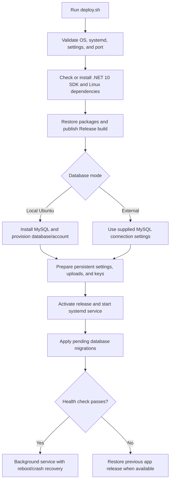
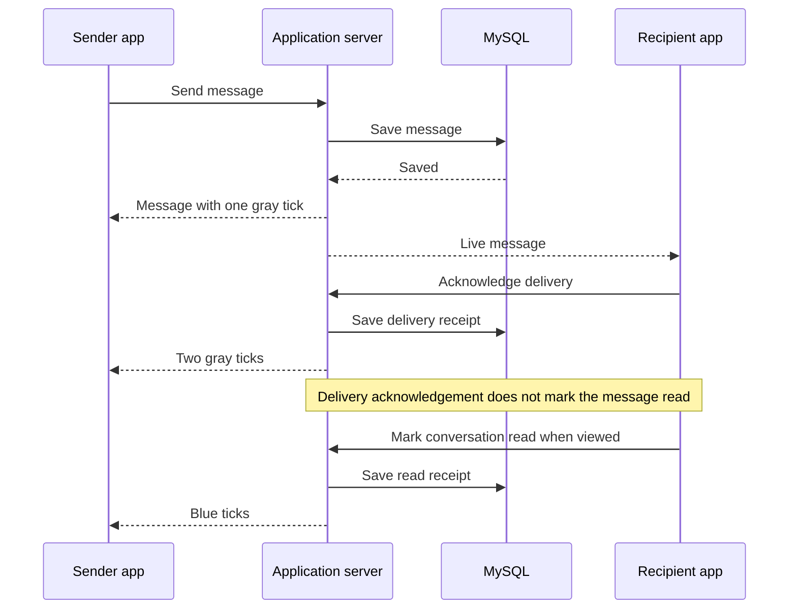

# WhatsAppSharp

A responsive C# messaging application built with **ASP.NET Core 10**, **Razor Pages**, **SignalR**, and **MySQL 8+**. It supports direct and group conversations, voice messages, communities, status updates, shared media, notifications, and direct voice/video calls. Accounts sign in with Google.

Run it locally or deploy it as a Linux background service. The Linux installer handles .NET, application dependencies, publishing, and—on Ubuntu—a new local MySQL database.

## Contents

- [Features](#features)
- [Architecture](#architecture)
- [Local development](#local-development)
- [Linux deployment](#linux-deployment)
- [Configuration](#configuration)
- [Database and persistent data](#database-and-persistent-data)
- [Message delivery and editing](#message-delivery-and-editing)
- [Project structure](#project-structure)
- [Testing](#testing)
- [Troubleshooting](#troubleshooting)
- [Further documentation](#further-documentation)

## Features

| Area | Capabilities |
| --- | --- |
| Accounts | Google sign-in, profiles, saved avatar colours, contact QR codes |
| Conversations | Direct chats, groups, communities, announcement chats, favourites, search, paged history |
| Messages | Replies, mobile swipe-to-reply, 15-minute editing, private/shared deletion, forwarding |
| Actions | One reaction per person, quick emoji reactions, pins, private stars and personal notes |
| Message info | Desktop side panel and mobile full-screen view with delivery/read receipts |
| Voice messages | Record, preview, discard, send, waveforms, seeking, playback speeds |
| Media | Images, documents, audio, video, stickers, shared media browsing |
| Calls | Full-screen direct voice/video calls, offline call invitations with push alerts, mute, camera controls, reconnection, call history |
| Social | Text/photo status updates with 24-hour expiry and community groups |
| App experience | Light/dark themes, responsive navigation, installable PWA, web push, quiet browser updates |

Messages and attachments are stored on the server; messaging is **not end-to-end encrypted**. Group calls are not implemented. Reliable calls across restrictive networks require a configured TURN relay.

## Architecture

Razor Pages render screens and handle HTTP requests. SignalR carries live chat events and call signalling. Application services persist data through Entity Framework Core's MySQL provider. WebRTC carries call media between devices, using a TURN relay when necessary.



The current deployment targets a **single application instance**. Presence, call coordination, and live connections use in-process state. Multiple application servers require shared coordination and a SignalR backplane or equivalent hosting arrangement.

## Local development

### Prerequisites

- **.NET 10 SDK**, including the C# compiler and ASP.NET Core tooling.
- A running **MySQL 8+** server and an account permitted to create/use the selected database and apply schema updates.
- Google OAuth web-application credentials to sign in.
- A modern browser. Microphone/camera and PWA features require HTTPS or a supported localhost development context.

NuGet packages restore through .NET. Node.js and Python are only needed for their respective test suites, not to run the application.

### 1. Create local settings

Run commands from the repository root unless stated otherwise.

**PowerShell:**

```powershell
Copy-Item .env.example .env
```

**Linux/macOS:**

```bash
cp .env.example .env
```

Edit `.env` before starting. Fill in `MYSQL_HOST`, `MYSQL_PORT`, `MYSQL_DATABASE`, `MYSQL_USER`, and `MYSQL_PASSWORD`. The template uses `messagingapp_db`; choose another database name if needed. Use a dedicated database account for deployed applications.

The app reads the root `.env` as settings, never as executable shell commands. Existing process environment settings take precedence. Keep credentials and private keys out of source control.

### 2. Configure Google sign-in

Register this authorized redirect URI in your Google OAuth web-application configuration for the local HTTP profile:

```text
http://localhost:5287/signin-google
```

Set your credentials in `.env`:

```dotenv
Authentication__Google__ClientId=YOUR_GOOGLE_CLIENT_ID
Authentication__Google__ClientSecret=YOUR_GOOGLE_CLIENT_SECRET
```

The URI must match the actual scheme, host, and port. Use `https://YOUR_DOMAIN/signin-google` in production. Configure the consent screen and test-user access as required by your Google project.

There is no public password-registration flow or demo login. Google sign-in creates an account on first use and requires verified Google email. The server can start without Google credentials, but sign-in remains unavailable until both credentials are configured and the server is restarted.

### 3. Start the application

For an optimized local build:

```bash
dotnet run --project src/MessagingApp --configuration Release --launch-profile http
```

Open **http://localhost:5287**. Use the server's printed URL if you changed the profile.

For the default Debug configuration:

```bash
dotnet run --project src/MessagingApp --launch-profile http
```

Plain `dotnet run` works **inside `src/MessagingApp`**. The repository root contains a solution rather than a runnable project, so use `--project src/MessagingApp` from the root.

To choose another local port:

```bash
dotnet run --project src/MessagingApp --no-launch-profile -- --urls http://localhost:8090
```

Keep `ASPNETCORE_ENVIRONMENT=Development` in the local `.env` for HTTP development and update the Google redirect URI to match the new origin. The `https` launch profile is also available at `https://localhost:7125`.

## Linux deployment

### Supported installer environments

| Server | Database options |
| --- | --- |
| Ubuntu 22.04, 24.04, 26.04 | Automatic local MySQL installation or existing external MySQL |
| Debian 12, 13 | Existing external MySQL 8+ server |

The installer requires Linux, `systemd`, administrative access through `sudo`, and Internet access for dependencies. Keep `deploy.sh`, `scripts/`, and `src/` together when copying the source. Omit generated build folders and private development runtime data.

### Deploy and manage the service on port 5287

From the project root on an Ubuntu server:

```bash
# Deploy: install dependencies, provision local MySQL, publish, and start
sudo bash deploy.sh --port 5287

# Stop / start / restart
sudo systemctl stop messagingapp
sudo systemctl start messagingapp
sudo systemctl restart messagingapp

# Service status
sudo systemctl status messagingapp --no-pager

# Follow logs; Ctrl+C exits the viewer without stopping the app
sudo journalctl -u messagingapp -f

# Local readiness check
curl http://127.0.0.1:5287/health
```

**Yes, default Ubuntu deployment creates the database.** It installs MySQL if needed, creates the `messagingapp` database and a dedicated account with a generated password, and applies table migrations at startup. No manual `schema.sql` import is required.

This creates a **fresh server database**; it does not copy your Windows/development database or attachments.



### Port, binding, and HTTPS

- `--port` accepts an available port from **1024–65535**.
- `sudo bash deploy.sh` prompts in a terminal; otherwise it uses the saved port or `8080` on first installation.
- The default bind address is `0.0.0.0`. Direct access is `http://YOUR_SERVER_IP:5287` when network/firewall rules permit it.
- For an HTTPS proxy on the same server, bind locally:

```bash
sudo bash deploy.sh --port 5287 --bind 127.0.0.1
```

The selected application port serves HTTP. Setup does not configure DNS, certificates, firewall rules, or a reverse proxy. Public Google sign-in and secure browser features need an HTTPS domain. The proxy must forward HTTP and WebSocket traffic to the application.

See [HTTPS and proxy configuration](docs/linux-deployment.md#https-and-the-selected-port) for trusted-proxy settings and an Nginx example. Adjust that guide's example port to `5287` when using the commands above.

### Configure sign-in after installation

```bash
sudo nano /etc/messagingapp/app.env
```

Set the Google client ID/secret and `AllowedHosts`, then restart `messagingapp`. Production push and TURN settings are optional feature configuration described below.

### Use an existing database

Use external mode for an existing MySQL server, including one on the same machine:

```bash
cp .env.example server.env
chmod 600 server.env

# Fill in database and Google settings in server.env first.
sudo bash deploy.sh --port 5287 --database external --env-file ./server.env
```

External mode does not install or reconfigure the database server. Your supplied account must have permission to create/use the chosen database and apply pending schema changes. Back up an existing database before deployment.

`--env-file` imports settings on the **first installation only**. Later edits belong in `/etc/messagingapp/app.env`. Switching an established installation between local and external modes requires a separate data migration.

### Deploy later server updates

Copy the updated source and rerun setup:

```bash
sudo bash deploy.sh
```

It preserves settings, the saved port/address/database mode, uploads, keys, and database data. To change ports, supply `--port` again and adjust the proxy/firewall and OAuth origin where needed.

Setup builds before activating the replacement release. On startup failure, it restores the previous app release and service when available. **Database migrations are not rolled back.** Keep backups and use migrations compatible with your recovery plan.

Quiet browser updates and server deployment are different: the browser activates updated assets automatically when safe; new C# server code still needs deployment or a server restart.

## Configuration

Use `.env` locally and `/etc/messagingapp/app.env` for an installed Linux service. Nested ASP.NET Core settings use double underscores. Restart after changing server configuration.

| Setting | Purpose |
| --- | --- |
| `ASPNETCORE_ENVIRONMENT` | `Development` locally; the installer forces `Production` |
| `MYSQL_HOST`, `MYSQL_PORT` | MySQL address; usual port is `3306` |
| `MYSQL_DATABASE` | Database name |
| `MYSQL_USER`, `MYSQL_PASSWORD` | Database credentials |
| `MYSQL_CHARSET` | Connection character set, normally `utf8mb4` |
| `ConnectionStrings__DefaultConnection` | Optional explicit connection string instead of `MYSQL_*` values |
| `Authentication__Google__ClientId`, `Authentication__Google__ClientSecret` | Google sign-in credentials |
| `AllowedHosts` | Allowed hostnames; multiple production names use semicolon separation |
| `WebPush__Subject`, `WebPush__PublicKey`, `WebPush__PrivateKey` | Production push contact and VAPID keys |
| `Calls__StunUrls` | Comma-separated STUN URLs |
| `Calls__TurnUrls`, `Calls__TurnSharedSecret` | TURN relay URLs and server-side shared secret |
| `Hosting__TrustedProxy` | Proxy IP whose forwarded headers are trusted |
| `Hosting__UseHttpsRedirection` | Enable after configuring HTTPS/proxy handling |
| `DataProtection__KeyPath`, `DataProtection__ApplicationName` | Stable encryption-key storage and application identity |

The installer manages binding and the listening port; copied URL settings do not override its selected port.

### Push notifications

Production push requires a stable VAPID pair and all three `WebPush__*` settings. Generate a pair once on a trusted machine:

```bash
dotnet run --project src/MessagingApp -- --generate-vapid-keys
```

Save the private key in private server configuration or a secret store; do not commit or publish the output. Development can generate and retain protected keys in `App_Data/vapid.protected` automatically.

Users enable notifications on their device. Closed-app alerts depend on browser/platform support and permission. Incoming alerts are quiet while an app window is focused; sent messages are silent. See [feature configuration](docs/features.md) for platform requirements and complete behavior.

### Voice and video calls

Configure a publicly reachable TURN relay for reliable calls across restrictive networks. The app supports a coturn-compatible shared-secret configuration and issues expiring relay credentials. The shared secret stays on the server.

See [voice and video calling](docs/features.md#voice-and-video-calling) for examples and verification limits. A local call does not establish that your deployed relay works across real mobile networks.

## Database and persistent data

### Schema lifecycle

Startup applies numbered scripts from `src/MessagingApp/Database/Migrations/` in filename order. `__SchemaMigrations` records applied scripts. Startup fails if database initialization fails.

- Add a new numbered script for a schema change; do not rename an applied migration.
- Keep `Database/schema.sql` synchronized as the complete manual-import reference.
- Preserve database data, attachments, and keys when moving an established deployment.
- No demo accounts are created. Startup removes identified legacy demo fixtures; test fixtures belong under `Tests/`.

### Files to preserve

| Location | Contents |
| --- | --- |
| Root `.env` | Private local configuration |
| `src/MessagingApp/wwwroot/uploads/` | Local attachments |
| `src/MessagingApp/App_Data/` | Local private application data and development push keys |
| `/etc/messagingapp/app.env` | Installed server settings |
| `/etc/messagingapp/service.conf` | Saved port, bind address, and database mode |
| `/var/lib/messagingapp/uploads/` | Installed server attachments |
| `/var/lib/messagingapp/keys/` | Installed server Data Protection keys |
| `/var/lib/messagingapp/app-data/` | Installed server private application data |
| `/opt/messagingapp/current` | Link to the active release |
| `/opt/messagingapp/releases/` | Published releases retained for recovery |

Back up **MySQL, uploads, configuration, and encryption/push keys** together. A rebuild does not recreate user data or lost keys. Generated `bin/` and `obj/` folders are build output, not backups.

For transferring existing data, follow [existing/external MySQL](docs/linux-deployment.md#existing--external-mysql).

## Message delivery and editing

| Indicator | Meaning |
| --- | --- |
| One gray tick | The server saved the message |
| Two gray ticks | Another participant's device acknowledged delivery |
| Blue ticks | A read receipt was recorded |
| Unsent offline draft | Remains a draft; it has no server-saved tick |

Online presence does not prove delivery. Recorded delivery remains after disconnection. Push-provider acceptance does not count as device receipt; the receiving worker acknowledges after displaying the notification. Receipt sync can acknowledge messages without opening that conversation or marking it read.



Additional rules:

- **Editing:** 15 minutes from the original send time. Further edits do not restart the deadline. The server checks the deadline when saving, including editors opened before expiry.
- **Reactions:** one per person per message. A new emoji replaces the previous choice; selecting the same emoji removes it.
- **Delete for me:** private to the acting account and preserved across devices.
- **Delete for everyone:** available to the sender or a group admin removing a group message.
- **Stars and notes:** private to the acting account.
- **Pins:** shared with chat members; up to three active pins for 24 hours, 7 days, or 30 days.
- **Voice messages:** half a second to ten minutes, within the 15 MB upload limit; voice messages cannot be edited.

Browser updates wait while unsent work or a call is active. Chats follow the bottom through content reflow until the user scrolls upward. Read the [feature guide](docs/features.md#message-actions) for further interaction details and limits.

## Project structure

```text
MessagingApp.slnx             Application and smoke-test solution
README.md                    Setup and operating guide
.env.example                 Configuration template
deploy.sh                    Linux installation and deployment
scripts/                     Deployment support code
src/MessagingApp/
  Program.cs                 Startup, authentication, hosting, service registration
  Configuration/             Environment and MySQL settings
  Data/                      EF Core context, initialization, SQL migration runner
  Database/Migrations/       Ordered schema changes
  Database/schema.sql        Complete schema reference
  Models/                    Entities and transfer objects
  Services/                  Accounts, messaging, calls, push, storage, maintenance
  Hubs/ChatHub.cs             Live chat and call signalling
  Pages/                     Razor screens and HTTP handlers
  wwwroot/                   Public assets and browser behavior
  Properties/                Development launch profiles
Tests/                       Integration, client, and installer checks
docs/                        Detailed guides and project notes
```

| Change | Starting point |
| --- | --- |
| Chat screen/rendering | `Pages/Chat/Index.cshtml`, `wwwroot/js/chat.js` |
| Menus, editing, notes, deletion | `wwwroot/js/message-actions.js`, `Pages/Shared/_MessageActions.cshtml` |
| Delivery acknowledgements/ticks | `wwwroot/js/message-receipts.js`, `Services/Messaging/MessageService.cs` |
| Keep the latest message visible | `wwwroot/js/chat-scroll.js` |
| Message info | `wwwroot/js/message-info.js`, `Pages/Shared/_MessageInfo.cshtml` |
| Voice recording/player | `wwwroot/js/voice-messages.js` |
| Calling | `wwwroot/js/calls.js`, `Services/Calls/CallService.cs` |
| Browser updates and push | `wwwroot/js/pwa.js`, `wwwroot/sw.js` |
| Styling | `wwwroot/css/app.css` |

Table paths are relative to `src/MessagingApp`. See [the project guide](docs/project-structure.md) for naming conventions and additional file locations.

## Testing

Run from the repository root:

```bash
# Compile the app and integration runner
dotnet build MessagingApp.slnx

# Integration checks using an available MySQL server
dotnet run --project Tests/SmokeTests

# Client behavior; requires Node.js
node --test Tests/*.test.mjs

# Installer checks; requires Python, with Bash for shell checks
python -m unittest discover -s Tests -p 'test_*.py' -v
```

Integration tests create uniquely named disposable databases on the configured MySQL server, run a separate app process on a free local port, and remove their test databases afterward. The account needs permission to create and drop those test databases. Synthetic sign-in fixtures do not introduce a public password-login route.

Coverage includes migrations, account boundaries, HTTP/SignalR behavior, editing deadlines, reactions, delivery/read receipts, uploads, voice validation, push-receipt tokens, and subscriptions. Client tests cover drafts, scrolling, overlays, receipt ordering, notifications, quiet updates, recording lifecycle, and calling behavior.

If Windows locks running build files, stop that app before rebuilding its output or use a separate artifacts directory. `MESSAGINGAPP_TEST_APP_DLL` can point the smoke runner at an already built application assembly.

Real-device microphone/codec behavior, production push delivery, and TURN across separate networks still need deployment-level checks. See [performance notes](docs/performance.md) for existing optimizations and measurement limits.

## Troubleshooting

| Symptom | Check |
| --- | --- |
| `dotnet run` cannot find a project | Run inside `src/MessagingApp`, or use `--project src/MessagingApp` from the root |
| Database/startup failure | MySQL availability, connection settings, permissions, and migration logs |
| Google sign-in unavailable | Both credentials are set; restart after changing them |
| Google redirect mismatch | Exact scheme, hostname, port, and `/signin-google` path |
| Linux service fails | `sudo journalctl -u messagingapp -n 100 --no-pager` and service status |
| Local access works, remote access fails | Bind address, selected port, firewall/security group, DNS, and proxy |
| Port occupied | Choose another `--port`; setup refuses another process's occupied port |
| Microphone/camera/notifications unavailable | HTTPS/localhost context, browser support, permissions, and PWA/platform requirements |
| Calls fail across networks | TURN credentials, public reachability, certificates, and relay-port rules |
| Build files locked on Windows | Stop the app using that output, or build to a separate artifacts path |
| Schema import then startup errors | Use complete current `schema.sql`, including migration records; do not manually rerun applied scripts |

Setup does not copy development data, configure your Google credentials, install an HTTPS proxy, or provision TURN. See [Linux deployment](docs/linux-deployment.md) for recovery and existing-MySQL details.

## Further documentation

| Guide | Contents |
| --- | --- |
| [Linux deployment](docs/linux-deployment.md) | HTTPS, external databases, persistent files, service recovery |
| [Features and configuration](docs/features.md) | Accounts, message rules, push, media, communities, status, calls |
| [Project structure](docs/project-structure.md) | Locations, naming conventions, generated/private data |
| [Performance](docs/performance.md) | Measurements, queries, client optimizations, local run settings |
| [Product notes](docs/product.md) | Product context |
| [Design notes](docs/design.md) | Interface direction and design context |

Mermaid diagrams render in supporting Markdown viewers, including GitHub. Other viewers may show the diagram source as code.
